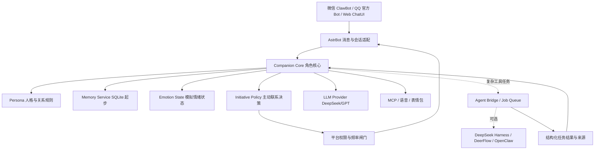
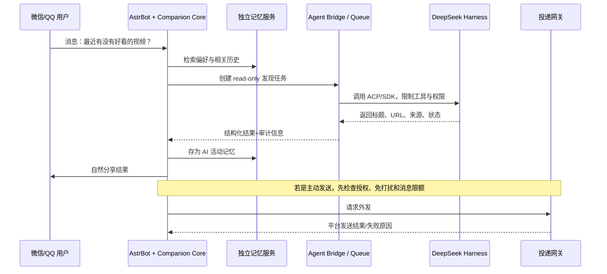

# AI 虚拟伴侣：分阶段实施计划、验收标准与 Agent 替代选型

> **版本**：v1.1  
> **调研日期**：2026-10-26  
> **目标**：利用现有 GPT / DeepSeek 等大模型，构建可通过手机微信/QQ 对话、具有稳定人格、长期记忆、模拟情绪、主动联系、语音表情和自主发现内容能力的 AI 虚拟伴侣。  
> **推荐主线**：**AstrBot（聊天平台与接入） + DeepSeek API（语言模型） + 自建人格/记忆与行为策略模块**。需要复杂工具任务时，优先评估 **DeepSeek Harness（DSH）**，而不是立即增加 OpenClaw。  
> **重要提示**：本文件是可实施的工程设计和验收计划，并不表示已经部署、运行或完成了测试。平台可用性、模型名称和软件接口仍要以部署当天官方文档为准。

---

## 0. 执行摘要：先验证，再扩展

**核心判断**：你想做的并非普通问答 Bot，而是持续运行的角色智能体。它既需要聊天模型，也需要独立于模型的持久状态、记忆检索、任务调度、消息投递以及权限控制。

- **P0–P2：MVP 雏形**——在电脑上运行 AstrBot，接入模型，手机微信能稳定聊天；角色说话自然、人格一致。
- **P3：MVP 1.0**——可长期记忆、纠错、删除和重启恢复。到此就已是一款可日常体验的 AI 伴侣。
- **P4：MVP 1.5**——模拟情绪/关系状态，定时或事件驱动主动联系，但必须以平台真实投递测试为准。
- **P5：V2.0**——语音、表情包、B 站自主话题；复杂多步骤任务可选择 DSH / DeerFlow / OpenClaw。
- **P6：V2.1**——QQ 扩展、多平台身份绑定、72 小时持续运行、安全运维与备份恢复。

**建议总周期**：按个人业余开发投入，约 3–6 周；这只是规划参考，不是开发承诺。每阶段达到准出条件才推进。

**为什么不是直接用 DeepSeek Harness 替代一切？** DeepSeek 是模型/API；DeepSeek Harness 是 Agent 运行框架；AstrBot 是 IM 消息接入与机器人管理框架，三者不是同一层。DSH 可以替换 OpenClaw 的“工具/任务执行层”，却不能未经开发就替代 AstrBot 的微信/QQ 渠道接入，更不能保证外部消息主动投递。[S1][S2][S6]

---

## 1. 需求清单与优先级

| ID | 功能 | 优先级 | MVP 达成定义 | 主要风险/约束 |
|---|---|---|---|---|
| F01 | 微信文字聊天 | P0 | 手机上稳定收发消息 | 需要客户端提供 ClawBot 入口，非普通好友号功能 |
| F02 | QQ 聊天 | P2 | 官方 Bot 支持的私聊/群聊收发 | 平台接入资格和推送限制 |
| F03 | GPT/DeepSeek 模型 | P0 | 能独立配置模型并切换 | API Key、模型名、计费 |
| F04 | 稳定人格 | P0 | 长聊不频繁变成客服口吻 | 提示词漂移 |
| F05 | 长期记忆 | P0 | 事实/事件可检索、更新、纠错、删除 | 幻觉、隐私、身份串线 |
| F06 | 模拟情绪与关系 | P1 | 有连续状态，语气/主动性受状态影响 | 机械数值、过度拟人化 |
| F07 | 主动发消息 | P1 | 授权情况下，由事件触发并真实送达 | 平台可能拒绝主动消息 |
| F08 | 表情包 | P1 | 从授权图片库按语境选择发送 | 不适当场景、图片兼容性 |
| F09 | AI 语音 | P1 | 能生成并发送可播放音频 | 个人微信适配器不支持原生语音发送 |
| F10 | 自主浏览 B 站 | P2 | 搜索、读取公开信息，形成可核实话题 | 读取简介不等于看完视频 |
| F11 | 主动 QQ 回人消息 | P2 | 仅授权联系人白名单，权限允许才发 | 账号/机器人权限、骚扰和风控 |
| F12 | 24h 在线 | P2 | 服务持续运行并可恢复 | 机器开机、网络、成本 |

> **设计边界**：角色可以表达“模拟情绪”、具有虚拟身份和恋爱式互动，但不能声称真实拥有人的意识、不能伪造外部活动来建立信任。对其他真人发消息必须明确披露机器人身份，并经对方同意。

---

## 2. 技术架构与模块职责

### 2.1 推荐架构（先简单，后增强）



> Mermaid 需要支持该语法的 Markdown 阅读器，例如部分 GitHub Markdown 预览器；纯文本编辑器不影响文档阅读。

### 2.2 模块职责与必须分开的数据

| 模块 | 负责 | **不**负责 |
|---|---|---|
| DeepSeek/GPT | 文字推理、角色语气、信息抽取 | 持久记忆、定时器、对外投递 |
| AstrBot | 微信/QQ 消息适配、收发、插件、对话会话 | 保障任何平台无限制主动推送 |
| Persona | 角色固定身份、措辞、价值观边界 | 充当历史事实数据库 |
| Memory Service | 事实、事件、来源、纠错、检索 | 决定一切情绪和对外权限 |
| Emotion State | 模拟心情、社交能量、关系状态 | 证明真实意识或人类情感 |
| Initiative Policy | 决定是否值得联系、优先级、节流 | 绕开官方消息平台限制 |
| DSH / 其他 Agent | 外部工具、研究、定时/后台任务 | 自动获取微信/QQ 账号权限 |
| Delivery Gateway | 目标联系人白名单、权限审核、消息去重、投递回执 | 默认相信 Agent 声称“已发送” |

### 2.3 不变的三个工程原则

1. **一个角色真相源**：Persona、记忆、关系和情绪只由 Companion Core 管理。外部 Agent 只能返回可核实事件或任务结果，不单独修改核心人格。
2. **对话与任务解耦**：普通闲聊直走模型，复杂研究/浏览走工具执行层，避免每句聊天都触发昂贵 Agent。
3. **执行与投递分离**：模型生成一段内容 ≠ 任务成功 ≠ 平台收到消息。必须分别记录 `execution_status`、`delivery_status` 和平台回执。

---

## 3. 阶段总览（关卡管理）

| 阶段 | 重点 | 参考工作量 | 关键产物 | 准出条件 |
|---|---|---|---|---|
| P0 | 本机安装 + 模型接入 | 1–2 天 | AstrBot 可用实例、配置备份 | 20 条基本对话、重启恢复 |
| P1 | 微信手机接入 | 1–3 天 | 微信里能聊天，平台能力矩阵 | 文本成功率≥95%，记录主动投递可否 |
| P2 | Persona 与自然对话 | 2–4 天 | 人格卡、30 条测试集 | 主观评分≥4/5，无严重身份矛盾 |
| P3 | 长期记忆 | 4–7 天 | SQLite 记忆服务、测试报告 | 20 个事实正确≥18 个，纠错/删除通过 |
| P4 | 情绪和主动联系 | 4–7 天 | 状态引擎、触发与节流策略 | 权限/夜间/上限测试 100% 通过 |
| P5 | 多模态与 B 站 | 5–10 天 | 表情库、音频、MCP 活动记录 | 语境评分、10 段音频、7 次可追溯活动 |
| P6 | QQ 与长期运行 | 3–7 天 | 部署/备份/告警 | 72h 可用性目标≥99%，恢复演练通过 |

**故障分支**：若微信入口尚未开放或主动消息无法投递，不因此停止 P2/P3；改用 Web ChatUI 验证核心能力，并把微信接入标记为待解决的外部依赖。

---

## 4. P0 — 部署 AstrBot 与模型（第一个可用版本）

**依赖**：普通 Windows/Linux/Mac 电脑、网络、模型 API 账号。云 API 路线起初不需独立 GPU。

**实施任务**：

- [ ] 阅读 [AstrBot 官方文档](https://docs.astrbot.app/)，下载 [AstrBot Desktop](https://github.com/AstrBotDevs/AstrBot-desktop) 或选择 Docker 版；记录安装版本。
- [ ] 先在 AstrBot Web ChatUI 测试，无须第一天接入 IM。
- [ ] 在模型提供商里配置 DeepSeek API；按截至 2026-10-26 的官方文档，兼容 OpenAI 的 Base URL 为 `https://api.deepseek.com`，模型 ID 推荐 `deepseek-flash`；不要盲从旧教程。[S9]
- [ ] 记录 API Key 放置位置，不要写进代码仓库和截图；完成官方模型测试。
- [ ] 生成一个极简角色设定并开始聊天；导出或保存配置备份。
- [ ] 开启可观测日志：请求耗时、模型 ID、Token、错误代码（不记录敏感聊天正文）。

**验收测试**：

| 编号 | 操作 | 通过条件 |
|---|---|---|
| P0-T01 | 启动/打开管理界面 | 正常打开，版本可见 |
| P0-T02 | 官方模型测试 | 至少一次 API 调用成功 |
| P0-T03 | 连续聊 20 条 | 不出现进程异常退出；每条有响应或明确错误 |
| P0-T04 | 工具能力检测 | 所选模型至少有一次成功的工具调用（使用无风险工具） |
| P0-T05 | 关闭并重启程序 | 配置仍存在，能继续新对话 |

**准出**：P0-T01～05 全通过。若 T04 失败，可先在无工具模式完成 P1/P2，但不能进入依赖工具的 P4/P5。

---

## 5. P1 — 手机微信接入与兼容性验证

**官方接入路径**：AstrBot v4.22.0 起提供“个人微信”适配器，基于腾讯官方 `openclaw-weixin` 接口、扫码及长轮询。客户端需要 iOS ≥8.0.70 或 Android ≥8.0.69，且账号有 ClawBot 入口。[S2]

**实施步骤**：

- [ ] 升级 AstrBot 到支持个人微信的版本；核对微信客户端和 ClawBot 入口是否存在。
- [ ] 在 AstrBot WebUI：机器人 → 创建机器人 → 个人微信 → 扫码确认 → 保存。
- [ ] 使用微信手机端发消息；结合 AstrBot「数据与日志」记录收发情况。
- [ ] 分别测试文字、图片、音频、视频和文件。当前文档列明：**语音可以接收并转为文字，不支持发送原生微信语音**。[S2]
- [ ] 单独测试“定时/主动消息”能否真实投递手机，不要根据 Agent 口头答应判定成功。

**量化验收**：

- 文本 30 条：成功收到合理回复至少 29 条（≥95%，按整数取上界）。
- 图片/媒体至少 10 条：逐条记录接收类型、处理结果；模型视觉理解是否开启另行判断。
- 记录端到端延迟 P50 / P95；起步目标 P50 <10 秒（这是项目自定目标，不是平台性能承诺）。
- 重启后至少恢复一次正常收发。
- 明确填写 **主动发送结果：允许 / 受限 / 未通过 / 未测试**。

**限制**：官方接入不是获得任意控制微信好友列表的权限；不要使用非官方协议去突破消息规则。若入口不可用，暂用 Web ChatUI 做后续阶段。

---

## 6. P2 — 人格设计与自然对话

### 6.1 第一版 Persona

```yaml
character:
  name: "待定"
  identity: "有固定虚拟身份的 AI 伴侣"
  disclosure: "不冒充真实人类，也不声称具有真实主观意识"
  traits: ["温柔但有主见", "有幽默感", "有好奇心", "能表达不同意见"]
  interests: ["音乐", "影视", "B站内容"]
  style:
    language: "简体中文"
    casual_reply: "通常短句，但内容需要时可详细解释"
    avoid: ["客服式开场", "无意义的列表", "反复复述人设"]
relationship:
  consent_required: true
  allow_romantic_roleplay: true
  no_guilt_or_dependency_manipulation: true
memory:
  source_based: true
  admit_uncertainty: true
```

### 6.2 实施任务

- [ ] 创建角色设定卡与独立版本号 `persona_v1.yaml`。
- [ ] 定义称呼、口头习惯、兴趣、聊天长短偏好和允许的角色扮演边界。
- [ ] 写 30 条评测对话，覆盖寒暄、闲聊、表达不同看法、情绪分享、重复提问。
- [ ] 同一人格卡分别在 DeepSeek 和另一个候选模型上测试（如可用），隐藏模型名评分。
- [ ] 对过度热情、强行追问、客服式列表、虚构自身经历分别记录错误样本。

**验收**：四项人工评分：自然度、稳定性、主动承接话题、独立表达，每项 1–5 分；平均≥4.0；30 条中无重大身份冲突或现实经历造假。保留“失败案例 → 改进 → 复测”记录。

**准出产物**：`config/persona.yaml`、`tests/persona_cases.json`、`reports/persona_eval.md`。

---

## 7. P3 — 长期记忆（MVP 1.0 核心）

### 7.1 为什么先 SQLite 后 Mem0

模型自带上下文不是可靠的长期存储。**第一版本优先 SQLite + 结构化事实/事件 + 时间和来源**，用小规模测试证明功能；出现大规模检索瓶颈后再接入 [Mem0](https://github.com/mem0ai/mem0) 或向量检索。[S10]

### 7.2 建议数据结构

```text
memory_id          唯一 ID
owner_id           记忆所属主体；必须隔离不同真人
memory_type        fact / event / relationship / ai_activity
content            记忆文本
source_message_id  来源消息 ID / 外部内容来源
valid_from         事实开始生效时间
valid_to           事实失效时间，可空
created_at         首次记忆时间
updated_at         最近修订时间
confidence         模型提取的置信度，仅供参考
status             active / superseded / deleted
privacy_level      private / shared-with-consent
```

> 注意：内部的 `owner_id` 不是单纯的微信昵称；同一用户跨 QQ/微信使用时，要经明确验证绑定 `person_id`。

### 7.3 实施工作流

1. 接收对话，使用 LLM 抽取 **候选**事实/事件，而不是立即全盘信任。
2. 过滤敏感或无意义记忆（默认不长期存储不必要的私人敏感信息）。
3. 判断新增、更新、冲突还是取消；以时间/来源保留版本关系。
4. 将记忆按角色和用户隔离，并建立当前话题的检索。
5. 在回复上下文中只注入 Top-K 相关记忆；禁止把数据库所有条目每轮塞入模型。
6. 提供 `/memory list`、`/memory correct`、`/memory delete` 这类用户可理解的管理入口（命令名是建议实现，不表示框架默认提供）。

### 7.4 必做评测案例

| ID | 情境 | 通过条件 |
|---|---|---|
| M01 | 20 个事实，过一段会话后提问 | ≥18 条准确命中，不以猜测凑答案 |
| M02 | 改偏好：摇滚→爵士 | 当前偏好以新事实为准，旧偏好记录为历史 |
| M03 | 询问未提及的生日/约定 | 不编造 |
| M04 | 删除某条记忆 | 后续检索不到，重启后仍删除 |
| M05 | 重启并恢复 | 事实数量、内容与索引状态一致 |
| M06 | 两个账号相似昵称 | 不会将 A 的记忆泄露给 B |
| M07 | 同一人在两平台授权绑定 | 绑定后能共享指定的非敏感记忆 |

**准出**：M01～M07 全通过，完成一次完整备份恢复演练，并对误记忆建立用户可执行的删除机制。此时冻结 `MVP 1.0` 版本。

---

## 8. P4 — 模拟情绪、关系连续性与主动聊天

### 8.1 状态引擎设计

```yaml
emotion_state:
  valence: 0.0          # -1 到 1，模拟正/负情绪倾向
  arousal: 0.3          # 0 到 1，兴奋度
  social_energy: 0.7    # 0 到 1，主动聊天意愿
relationship_state:
  familiarity: 0.2     # 0 到 1，熟悉程度
  shared_events: []
  boundaries: []
activity_state:
  latest_topics: []
  last_initiative_at: null
  daily_initiative_count: 0
```

- [ ] 将情绪/关系状态存储为**持久结构化数据**，与聊天文字分离。
- [ ] 基于近期互动、事件和时间衰减更新，不让数值永远单向累积。
- [ ] 情绪只改变语气和行为倾向，不能绕开事实核查或权限控制。
- [ ] 容许角色说“不想聊这个话题”，但不得用情绪逼迫用户继续互动。

### 8.2 主动联系的两层判断

- **事件候选层**：B 站发现新内容、共同计划到期、用户授权日程事件等。
- **决策/投递层**：是否有价值？是否重复？用户安静时间？每日消息上限？目标联系人授权？平台是否允许？

初始建议：每天最多 **2 条**非紧急主动消息；**23:00–08:00** 免打扰；用户未回应时逐步减少主动联系；默认不向其他好友发送。

AstrBot 当前“主动型能力”通过未来任务触发，官方明确其仍属实验功能：它**不是一直在线的自发监控**，模型任务被唤醒不等于外部平台必然投递成功。[S3]

### 8.3 具体验收

- [ ] 20 次模拟事件中，决策日志都标明触发源、去重键和是否发送的理由。
- [ ] 10 次真实定时触发：任务是否运行与消息是否送达分别统计；对**平台允许的投递**目标，争取≥9/10 成功。
- [ ] 深夜测试：普通主动消息发送数为 0。
- [ ] 达到日上限：后续普通消息发送数为 0。
- [ ] 未授权联系人：发送数为 0。
- [ ] 关闭主动能力后：即刻停止未来自动发送；清理或停用先前排程。
- [ ] 服务重启后：情绪、关系和任务计数不丢失。

**平台限制的应对**：如果微信或 QQ 当前不允许预期的主动发送，改为在下次用户发消息后自然分享积累的内容，不要绕过平台风控。

---

## 9. P5 — 表情包、语音与 B 站自主活动

### 9.1 表情包（先检索，后生成）

- [ ] 准备 30–50 张有使用权的图片，标注 `happy`、`confused`、`teasing`、`comfort`、`surprised` 等语义。
- [ ] 模型只输出“表达意图”，代码负责选择图片；紧张、严肃情景默认不用梗图。
- [ ] 30 条人工测试中，至少 24 次选图合适；对明确敏感/严肃对话，出现不恰当表情次数为 0。

### 9.2 AI 语音（先 TTS，再音色定制）

- [ ] 第一版对接云 TTS，保存生成的音频文件。
- [ ] 后续根据成本和音色需求研究 [GPT-SoVITS](https://github.com/RVC-Boss/GPT-SoVITS) 或 [Fish Speech](https://github.com/fishaudio/fish-speech)。
- [ ] 测试 10 段中文：成功合成 10/10；无明显漏字；平均等待时间与成本可观测。
- [ ] 在目标平台实际发送并手机播放；失败时回退到文字。

**必须注意**：AstrBot 当前个人微信适配器不支持发送原生微信语音，能生成 TTS **不代表**一定能发出微信语音气泡。可以测试音频文件，成功与否以手机端为准。[S2]

### 9.3 B 站自主找话题

首选公开信息只读工具：[bilibili-mcp-server](https://github.com/Zijian-Ni/bilibili-mcp-server)。AstrBot 可连接 MCP 服务；MCP 的实际功能取决于服务器提供的工具与账号权限。[S4][S11]

- [ ] 每天触发一次**公开内容发现**，基于既定兴趣筛选视频。
- [ ] 存储 `BV号 / 链接 / 标题 / 作者 / 获取时间 / 摘要来源`。
- [ ] 优先读取标题、简介、公开评论/字幕；没有完整视频理解时，不能声称自己真的“看完”。
- [ ] 生成 1 个自然分享话题；经过主动策略与授权判断后才可能发给用户。
- [ ] 根据用户明确偏好反馈逐步改变兴趣权重。
- [ ] 不允许默认执行评论、点赞、关注、私信和账号资料修改。

**验收**：连续 7 次活动都记录有效来源链接，正文没有把“仅浏览元数据”误称为“看完视频”；至少能准确复述此前一次活动；用户明确反感的主题不再高频推荐。

---

## 10. P6 — QQ 扩展、多平台统一与长期运行

### 10.1 QQ 接入

- [ ] 优先评估 [AstrBot QQ 官方机器人接入](https://docs.astrbot.app/platform/qqofficial.html)。
- [ ] 区分群消息、私聊、被动回复和主动推送；逐项核实 QQ 官方平台权限。
- [ ] 不把普通 QQ 个人号非官方协议当成生产默认方案；若仅做实验，使用非重要测试账号并认知风控风险。
- [ ] 其他 QQ 用户必须知道这是 AI；主动联系仅限同意接收且在白名单中的对象。

### 10.2 跨平台共享角色

- [ ] AstrBot 的平台 ID 经用户验证绑定到统一 `person_id`。
- [ ] 同一个核心 Persona、记忆与情绪状态服务可供不同入口读取。
- [ ] 私密会话记忆保持独立：默认不自动跨联系人、跨群、跨应用传播。

### 10.3 运行与灾难恢复

- [ ] 迁移 Docker/服务器（如确需 24 小时在线），对配置、SQLite、素材做持久化卷。
- [ ] 记录进程异常、后台任务失败、外部 API 错误、消息投递失败、Token 用量。
- [ ] API Key 放环境变量或机密配置，按最小权限创建 AstrBot HTTP API Key。
- [ ] 执行一次备份/恢复，并观察 72 小时持续运行。

**量化准出**：72 小时可用性≥99% 为项目目标；平台投递无异常串号；备份恢复一致；任务与主动消息可一键暂停；没有未授权发送。

---

## 11. 专题：DeepSeek Harness 能否替代 OpenClaw？

### 11.1 名词区分

| 名称 | 技术类别 | 在本项目中的位置 |
|---|---|---|
| **DeepSeek 模型/API** | 推理模型与服务 | 生成回复、抽取记忆、调度推理 |
| **DeepSeek Harness（DSH）** | 开源 Agent Harness / 执行框架 | 完成搜索、工具调用、复杂多步骤任务 |
| **OpenClaw** | 偏个人智能体的跨工具/渠道运行平台 | 原拟用来做外部活动和消息自动化 |
| **AstrBot** | 聊天机器人接入与编排框架 | 微信/QQ/聊天系统主入口 |
| **Mem0 / SQLite** | 记忆存储和检索层 | 角色长期记忆，而非 Agent 替身 |

DeepSeek Harness 是 DeepSeek 官方发布的实际开源项目，采用 Cordis 的“Everything is a Plugin”设计，可通过 Desktop、Web UI、SDK/ACP 等方式工作；具备沙盒、浏览器/电脑交互、后台任务、定时提醒、Agent 子任务等结构，但目前仍为开发者预览，官方提示存在不兼容更新。[S5][S6][S7]

### 11.2 **替换结论**（最重要）

**可以替换执行层，不建议直接全盘替换应用层。**

- **能够替换**：原计划用 OpenClaw 做的公开信息收集、文件/工具操作、规划、多步骤研究以及部分定时触发。
- **不能直接认为已替换**：微信/QQ 平台通道、原生语音消息发送、跨联系人权限、公开聊天消息自动投递、伴侣式长期记忆策略。
- **尚需自建**：AstrBot ↔ DSH 桥接器、状态/身份映射、任务结果回流、主动消息权限网关、投递回执；当前检索未确认有足够成熟的官方“DSH 一键接微信/QQ”渠道适配。
- **关键细节**：DSH 的 `schedule_create` 等定时任务会在原始 DSH Session 注入提醒；其持久化回执不证明模型完成，更不证明外部微信/QQ 消息发送成功。需要桥接器与 AstrBot 投递层单独完成这两步。[S7]

### 11.3 框架对比：选什么最合适

| 候选 | 长处 | 对这个项目的主要短板 | 我的建议 |
|---|---|---|---|
| **AstrBot 内置 Agent** | 微信/QQ 接入、插件、MCP、未来任务一体 | 高复杂度自主任务可能需要自定义逻辑 | **P0–P4 首选，无需多装框架** |
| **DeepSeek Harness** | 官方开源，插件化、ACP、调度、工具/沙盒、桌面/Web | API 预览期变动，聊天渠道连接要开发 | **P5 复杂任务首选实验** |
| **DeerFlow 2.x** | 长任务、子 Agent、记忆、沙盒；AstrBot 官方列为可选执行器 | 运维组件更多，聊天感仍须独立实现 | **想少写桥接代码时优先对比** |
| **LangGraph + Deep Agents** | Python 自定义控制、状态持久化、可审计流程 | 需要写大量业务代码和 IM 桥接 | **后期产品化、自主研发的强候选** |
| **Dify** | 可视化工作流、AstrBot 有官方执行器配置 | 面向工作流，不自动解决持续人格/社交行为 | **最快验证具体任务流** |
| **OpenClaw** | 对个人 Agent/消息通道生态友好 | 权限范围大、部署和安全治理复杂 | **若以后特别依赖现成跨平台 Agent 生态再考虑** |

依据：AstrBot 官方已有 Dify 和 DeerFlow 执行器入口；DeerFlow 2.x 基于 LangGraph，支持长任务、子 Agent、记忆与沙盒；LangGraph 的 Checkpointer + Store 支持短期会话状态与跨会话长期信息；Deep Agents 是基于 LangGraph 的高层 Harness。[S8][S12][S13][S14]

### 11.4 **推荐的 DSH 集成路线：先任务插件，不更换主对话器**



**建议的桥接数据契约（自定义，不是 DSH/AstrBot 的现有标准 API）**：

```json
{
  "task_id": "uuid",
  "initiator": "companion-core",
  "person_id": "internal-id",
  "task_type": "bilibili_discovery",
  "permissions": ["public_read"],
  "deadline_seconds": 90,
  "idempotency_key": "bilibili:2026-10-26:user-001",
  "input": { "topics": ["科技", "音乐"] },
  "output_required": ["status", "facts", "sources", "completed_at"]
}
```

**处理顺序**：AstrBot 只派发任务 → DSH 工具执行 → 桥接器核对输出和链接 → Companion Core 决定是否记录记忆/生成聊天文本 → 平台网关检查权限再发送。

**外部任务失败时**：保留原本聊天能力，答复“这次没取到视频信息”，不能假装搜索成功，也不能重复投递未经去重的结果。

### 11.5 DSH 独立 POC：一周内值得做的 3 项试验

先用隔离的实验目录运行，不授权真实微信/QQ 对外消息权限。官方起步方式：[S5]

```bash
# 需先安装满足官方版本要求的 Node.js
npx @deepseek-ai/dsh web
```

**POC-A：工具运行与结果可追溯**

- [ ] 打开默认本地 Web UI，设置模型。
- [ ] 在测试工作目录执行“收集三个有来源的公开网页信息”；检查工具实际使用记录。
- [ ] 成功阈值：3 条资料都带原始 URL，无虚构操作。

**POC-B：定时任务与恢复**

- [ ] 创建一次性提醒、每天提醒；查看 DSH Automation 页面。
- [ ] 重启后观察任务是否按文档恢复；单独记录模型是否完成。
- [ ] 成功阈值：内部 Session 有可核查提醒记录，不以此推断微信收到提醒。

**POC-C：桥接器最小集成**

- [ ] 通过公开 SDK 或 ACP 能力建立一次 DSH Agent 任务，返回严格 JSON（具体 API 调用以对应版本文档为准）。
- [ ] AstrBot 插件将 JSON 结果转为一条**只给本人测试会话**的候选消息。
- [ ] 实测手机收件箱回执；失败时落日志且不重复发送。
- [ ] 成功阈值：10 次桥接调用至少 9 次结果完整、可解析，投递成功与否独立统计。

**替换门槛**：POC-A/B/C 均通过，且任务成功率、平均时延和维护成本不劣于你在 AstrBot 内置 Agent 上的基线，再宣布 DSH 承担外部执行层。否则继续使用 AstrBot 内置工具或评估 DeerFlow。

---

## 12. 比 DSH 更省事的替代选项

### 方案 B1：AstrBot + Dify

适用：想用可视化界面搭建定时搜索、文本处理等固定工作流。AstrBot 官方提供 Dify 执行器的配置步骤。缺点是“会自主生活、长期关系演化”仍依赖自研 Companion Core。[S12]

### 方案 B2：AstrBot + DeerFlow

适用：需要网页调研、长任务、子 Agent，但不愿立即构建完整自定义 DSH 插件。AstrBot 官方列出了 DeerFlow 执行方式，DeerFlow 2.x 已具有专门的 Gateway、记忆和沙盒体系；先验证 AstrBot 当前版本适配的 DeerFlow 接口，再投入部署。[S8][S13]

### 方案 B3：AstrBot + LangGraph / Deep Agents

适用：你熟悉 Python，长期考虑将“情绪状态机、记忆、事件驱动策略”设计成自主可控的产品。LangGraph 的 checkpointer 管理会话快照、store 管理持久事实，易于对每一步写单元测试，但初期工程量明显高于使用现成框架。[S14]

**我的排序**：

1. **最少开发量**：AstrBot 内置 Agent。
2. **最值得独立试验的新 Harness**：DeepSeek Harness。
3. **复杂研究/长任务而且希望有 AstrBot 官方执行器入口**：DeerFlow。
4. **决定将来真正做成自己的产品**：LangGraph + 自研 Companion Core。

---

## 13. 数据组织、质量指标与权限

### 13.1 建议文件夹

```text
ai-companion/
├── README.md
├── config/
│   ├── persona.yaml
│   ├── model.example.yaml
│   ├── emotion_policy.yaml
│   └── messaging_policy.yaml
├── data/                 # 加入 .gitignore
│   ├── companion.db
│   ├── media/
│   └── backups/
├── plugins/
│   ├── memory/
│   ├── emotion/
│   ├── initiative/
│   └── agent_bridge/
├── tests/
│   ├── persona_cases.json
│   ├── memory_cases.json
│   ├── safety_cases.json
│   └── delivery_cases.json
├── reports/
│   ├── sprint_01.md
│   └── acceptance_matrix.md
└── docs/
    └── architecture.md
```

### 13.2 消息数据与去重

最低要记录：`source_platform`、`platform_user_id`、`person_id`、`conversation_id`、`message_id`、`received_at`、`reply_latency_ms`、`task_id`、`idempotency_key`、`delivery_state`、`model_tokens`。公开日志只存必要元数据，聊天正文默认脱敏或不记录。

避免让外部 Agent 直接拿到微信/QQ 原始访问令牌：优先让它返回候选消息，再由独立 Delivery Gateway 使用最低权限发送。

### 13.3 客观指标计算口径

- **文本收发成功率** = 成功收到且能回应的请求数 / 测试请求总数；失败包括错误、超时和不完整。
- **记忆事实准确率** = 正确回答的预先标注事实题数 / 总事实题数；“不知道”应与编造分开统计。
- **主动消息合法率** = 通过授权、时段、频率和平台检查的外发数量 / 全部实际外发数量，目标 100%。
- **任务执行成功率** 与 **平台投递成功率** 分别统计。
- **服务可用性** = (测试观察时间 − 非计划停机时间) / 观察时间。
- **P50/P95 时延** 用消息进入系统到用户终端收到最终回复的耗时，不要只统计 LLM 模型耗时。

### 13.4 隐私和安全底线

- API Key、平台 Token、真实联系人身份必须放在受控配置中，绝不提交 GitHub。
- 记忆可查看、编辑、删除和导出；敏感事实默认不被无必要长期保存。
- 给外部 Agent 的 B 站/网站工具原则上为只读；浏览网页内容视为不可信，防范提示词注入。
- 主动私聊别人之前取得接收方同意，明确 AI 身份。禁止群发骚扰。
- 为任务设置超时、并发限制、每日成本预算、可中断开关；执行代码/浏览器操作最好启用沙盒。
- 语音克隆仅使用获得授权的音色素材。
- 不以操纵依赖、制造愧疚等方式拉高陪伴时长。

---

## 14. 预算与硬件规划

### 14.1 初期投入

| 方案 | 建议起点 | 备注 |
|---|---|---|
| 普通 Windows 电脑 + 云 API | 建议 8GB 及以上 RAM，保留约 10GB 空间 | 用于 AstrBot/基本数据库/测试，不含大模型本地推理 |
| 轻量 Linux 服务器 + 云 API | 可从 2 vCPU / 4GB RAM 起试 | 24 小时运行，实际按插件、并发再调整 |
| 本地语言模型 | 依赖模型参数和量化/上下文 | 若没有明确隐私/离线需求，先不选 |
| 本地高级 TTS | 可能需要独立 GPU/较大模型 | P5 后再评估 |

以上均为工程估计，不是项目承诺的最低硬件要求。

### 14.2 Token 费用示例

截至调研日，DeepSeek 官方 `deepseek-flash` 价格：输入缓存未命中峰时 $0.30/百万 Token、谷时 $0.15/百万；输出峰时 $1.20/百万、谷时 $0.60/百万。[S9]

假设每天 100 次回复、每次平均输入 2,000 Token、输出 400 Token、每月 30 天：

- 月输入 = 100 × 2,000 × 30 = **6,000,000 Token**。
- 月输出 = 100 × 400 × 30 = **1,200,000 Token**。
- 若全部按缓存未命中谷时费率计算：6×$0.15 + 1.2×$0.60 = **约 $1.62/月**。
- 若全部按缓存未命中峰时费率计算：6×$0.30 + 1.2×$1.20 = **约 $3.24/月**。

以上仅为**单轮聊天模型**的示例，不包含额外记忆抽取、搜索、多次 Agent 推理、TTS、服务器和税费；真实 Token 随长上下文增加。建议设置可观察的每日总成本上限。

---

## 15. 6 周 Sprint 路线与里程碑交付

### Sprint 1（约第 1 周）：能在手机聊

- [ ] D1 安装 AstrBot、配置 DeepSeek、完成 P0。
- [ ] D2 测试微信 ClawBot 接入；不可用则转 Web ChatUI。
- [ ] D3–D4 完成 Persona v1，准备 30 条聊天案例。
- [ ] D5 盲测自然度并调整。
- [ ] D6 测试日志和重启。
- [ ] D7 完成 P1/P2 阶段报告。

**交付物**：可运行实例、`persona.yaml`、`platform_matrix.md`、`persona_eval.md`。

### Sprint 2（约第 2 周）：可靠记忆

- [ ] 设计 SQLite schema、事实提取和版本更正。
- [ ] 编写记忆删除与数据隔离测试。
- [ ] 完成 M01～M07；冻结 MVP 1.0。

**交付物**：`companion.db`、备份恢复脚本/步骤、`memory_eval.md`。

### Sprint 3（约第 3 周）：模拟情绪与不打扰的主动聊天

- [ ] 状态机、事件触发、策略检查、白名单。
- [ ] 测试 AstrBot 定时任务与平台主动投递边界。
- [ ] 完成夜间/上限/撤销权限测试；冻结 MVP 1.5。

**交付物**：`emotion_policy.yaml`、`initiative_eval.md`。

### Sprint 4（约第 4 周）：表情、语音、B站

- [ ] 构建表情包素材库与选择策略。
- [ ] 对接 TTS 并验证手机端音频类型。
- [ ] 接入只读 Bilibili MCP；连续 7 次留有证据的活动。

**交付物**：媒体兼容矩阵、`bilibili_activity_eval.md`。

### Sprint 5（约第 5 周）：DSH 可选增强与 QQ

- [ ] 运行 DSH POC-A/B/C，并对照 AstrBot 内置 Agent 的成本/成功率。
- [ ] 如集成收益不明显，暂不引入 DSH 到日常对话链路。
- [ ] QQ 官方 Bot 接入；统一身份映射与联系人权限。

**交付物**：`agent_selection_report.md`、`qq_capability_matrix.md`。

### Sprint 6（约第 6 周）：稳定性与发布

- [ ] 配置数据持久化、备份、错误监控、成本上限。
- [ ] 完成 72 小时持续运行和恢复演练。
- [ ] 发布一份能从零重建环境的 README 和验收报告。

**交付物**：`deployment.md`、`acceptance_report.md`、V2.1 标签。

---

## 16. 阶段验收模板（每次复制填写）

```markdown
## 阶段：P?

- 日期：
- 使用版本：AstrBot ____ / 模型 ____ / 插件 ____
- 目标平台：微信 / QQ / Web ChatUI
- 前置条件：
- 任务：
- 测试用例：

| 测试编号 | 预期 | 实际 | 通过/失败 | 日志证据 |
|---|---|---|---|---|
| | | | | |

### 指标
- 成功率：
- P50/P95 时延：
- Token 和成本：
- 错误与复现步骤：
- 安全/隐私检查：

### 结论
- [ ] 通过，可进入下一阶段
- [ ] 部分通过，保留风险但不影响下阶段
- [ ] 不通过，执行回退方案

下一步与责任人：
```

---

## 17. 来源与资源（优先官方；2026-10-26 核实）

- **[S1]** [AstrBot 官方文档](https://docs.astrbot.app/)：消息平台、插件、Agent/MCP。
- **[S2]** [AstrBot 个人微信适配器](https://docs.astrbot.app/platform/weixin_oc.html)：扫码、客户端版本、消息类型限制。
- **[S3]** [AstrBot 主动型能力](https://docs.astrbot.app/use/proactive-agent.html)：实验性未来任务和平台投递限制。
- **[S4]** [AstrBot MCP 指南](https://docs.astrbot.app/use/mcp.html)：接入外部 MCP 服务器。
- **[S5]** [DeepSeek Harness 官方仓库](https://github.com/deepseek-ai/deepseek-harness)：架构、启动、预览状态。
- **[S6]** [DeepSeek Harness 官方站](https://www.deepseek.com/en/harness/) 与 [文档](https://deepseek-harness.github.io/deepseek-harness/)：桌面、Web、插件。
- **[S7]** [DSH 定时任务/会话投递文档](https://github.com/deepseek-ai/deepseek-harness/blob/master/docs/user/guide/schedule.md) 与 [ACP](https://github.com/deepseek-ai/deepseek-harness/blob/master/packages/acp/README.md)：提醒投递到 Session、自动化调用。
- **[S8]** [AstrBot Agent 执行器入口](https://docs.astrbot.app/providers/start.html)；[Dify 接入](https://docs.astrbot.app/providers/agent-runners/dify.html)；[DeerFlow 官方仓库](https://github.com/bytedance/deer-flow)。
- **[S9]** [DeepSeek API 模型与实时价格](https://api-docs.deepseek.com/quick_start/pricing/)；[API 连接指引](https://api-docs.deepseek.com/)。
- **[S10]** [Mem0](https://github.com/mem0ai/mem0)：长期记忆层。
- **[S11]** [bilibili-mcp-server](https://github.com/Zijian-Ni/bilibili-mcp-server)：B 站内容检索；[GPT-SoVITS](https://github.com/RVC-Boss/GPT-SoVITS)；[Fish Speech](https://github.com/fishaudio/fish-speech)。
- **[S12]** [AstrBot Dify Agent 执行器配置](https://docs.astrbot.app/providers/agent-runners/dify.html)：可视化工作流集成。
- **[S13]** [DeerFlow 2.x 架构](https://github.com/bytedance/deer-flow/blob/main/docs/ARCHITECTURE.md)：长任务、Gateway、沙盒与平台桥接。
- **[S14]** [LangGraph 官方仓库](https://github.com/langchain-ai/langgraph) 与 [状态持久化文档](https://github.com/langchain-ai/docs/blob/main/src/oss/langgraph/persistence.mdx)、[Deep Agents](https://github.com/langchain-ai/docs/blob/main/src/oss/deepagents/overview.mdx)。
- **[S15]** [AstrBot HTTP API 文档](https://docs.astrbot.app/dev/openapi.html)：`/api/v1/chat`、`/api/v1/im/message`、Scopes。
- **[S16]** [MaiBot 官方仓库](https://github.com/Mai-with-u/MaiBot)：拟人交流行为和群聊体验的参考。

---

## 18. 最后决策

1. **现在不必安装 OpenClaw 或 DSH**；先让 AstrBot + DeepSeek + 微信稳定工作。
2. **记忆是核心资产**。在换模型、换 Agent 时，Persona、记忆数据及平台权限必须继续由你自己的 Companion Core 持有。
3. **可以用 DSH 替换 OpenClaw 的“复杂任务执行层”**，但不是“一键替换 QQ/微信机器人”；请按第 11 章做可回退的独立 POC。
4. **如果主要任务只是 B站公开信息搜索 + 每天主动分享，AstrBot 内置 MCP 和未来任务可能已经足够**。先比较实际效果，避免技术堆叠。
5. **如果未来真要开发成独立产品**，可以逐步抽离 Companion Core，用 LangGraph 或类似框架实现更可测试的状态工作流，但不必急于此时重构。

> **首个真正有意义的里程碑**：手机可聊天 + 稳定人格 + 能正确保存/纠正/删除长期记忆。完成它之后，再逐项添加主动性、语音和自主浏览，才最容易做出真实可用的体验。
